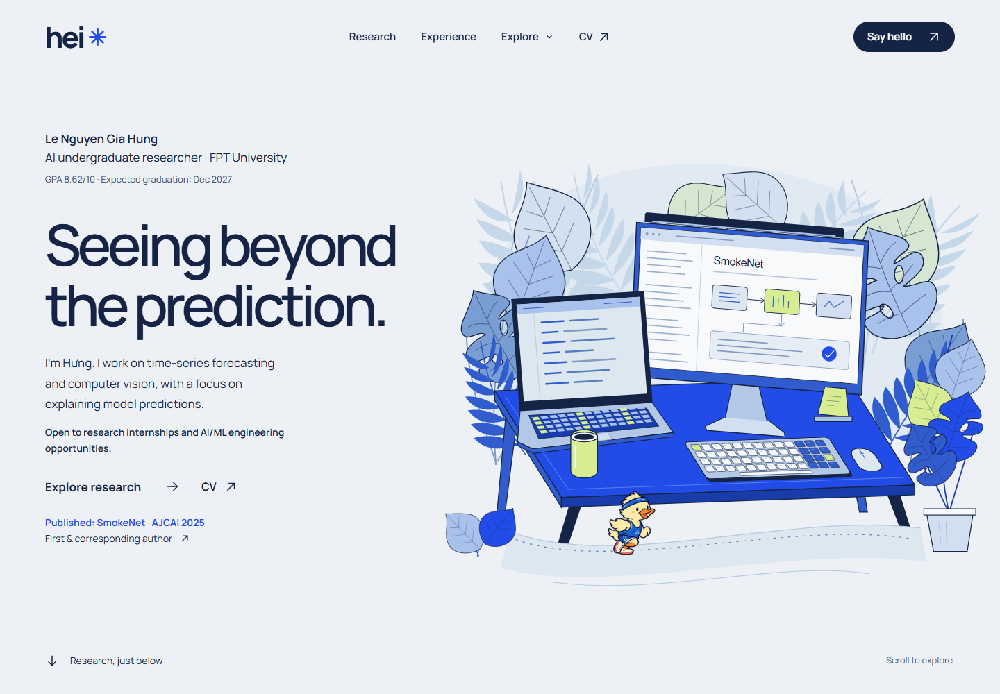

# hei · Le Nguyen Gia Hung

My corner of the internet for AI research, projects and things in motion.
I'm an AI undergraduate at FPT University, interested in explainable AI,
computer vision and time-series forecasting.

[Visit the portfolio](https://hei-portfolio.vercel.app) ·
[Research CV](public/HungLNG_Resume.pdf) ·
[AI/ML résumé](public/HungLNG_Resume_AI_ML.pdf) ·
[LinkedIn](https://linkedin.com/in/le-nguyen-gia-hung/)

[](https://hei-portfolio.vercel.app)

## Inside

- A layered, illustrated workspace inspired by my desk, surrounded by tropical
  plants. The running duck takes breaks too.
- Publications with authorship and status visible, followed by project summaries
  and detailed case studies. Published work and manuscripts under review stay separate.
- A draggable motion ribbon, floating navigation and a small optional playground.
- Writing, research and industry CVs, plus A4 print editions with a portfolio QR.

Motion respects the system's reduced-motion preference and the site's shared
pause control. The opening is skippable; the content is server-rendered and
remains readable without JavaScript.

## Run locally

Use Node.js 22 LTS (22.9+) and npm.

```sh
git clone https://github.com/hei1sme/hei-portfolio.git
cd hei-portfolio
npm ci
npm run dev
```

Open [localhost:3000](http://localhost:3000). No API keys are required.

```sh
npm run lint
npm run typecheck
npm run audit:code -- --check
npm run build
npm start
```

Built with **Next.js 15, React 19, TypeScript and Tailwind CSS 3**. MDX powers
the writing and case studies. Framer Motion supports the playground; Three.js
is loaded on demand for the preserved sculpture comparisons.

## Find your way around

| Path | Contents |
| --- | --- |
| `app/page.tsx` | Homepage composition |
| `app/concepts/garden/` | Current homepage, illustrated scenes and research sections |
| `app/components/portfolio/` | Navigation, motion, duck, cursor and shared page shell |
| `content/` | Published blog posts and project cases in MDX |
| `lib/` | Content loaders, site settings and applied-work data |
| `cv/` | Editable LaTeX sources for all four CV editions |
| `public/` | Website images and downloadable CVs |
| `design/` | Design decisions, artwork sources and archived explorations |

The `garden` source name comes from the original concept. It now serves the
production homepage. The earlier courtyard is preserved at
[`?scene=botanical`](https://hei-portfolio.vercel.app/?scene=botanical).

[Maintenance and deployment](CONTRIBUTING.md) ·
[CV build instructions](cv/README.md) ·
[Design documentation](design/README.md) ·
[Content backlog](notes/portfolio-backlog.md)

## Credits and license

Code is licensed under [MIT](LICENSE). Research papers and linked project
repositories retain their own terms. The workspace and courtyard are authored
SVG illustrations; the duck artwork was generated with AI and animated in code.
[Artwork provenance](design/duck-cursor-and-blog-cover.md) and
[vendored skill sources/licenses](.agents/skills/SOURCES.json) are retained.
The private workspace photo, paper drafts and certificates are excluded from Git.
